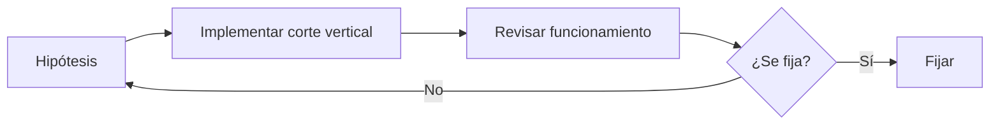

# 00 — Contexto: lineamientos 0 → 1

Estos lineamientos rigen cómo el Architect planifica una funcionalidad en un producto que todavía no ha encontrado su forma definitiva.

## Ciclo de aprendizaje

- El desarrollo avanza por ciclos: implementar → revisar → fijar.
- Mientras no haya revisión, el alcance, el diseño y los nombres son reversibles.
- El criterio para cerrar una decisión es: costo de revertir × valor de la evidencia que falta.
- Las decisiones de alto costo de reversión se planifican en una dev branch de base de datos, local y remota.
- Cada archivo 01–07 elige el lineamiento original o su alternativa contraria según maximice el aprendizaje por unidad de costo irreversible.

## Cómo leer 01–07

| Archivo | Tema                           |
| ------- | ------------------------------ |
| 01      | Alcance y momento de decisión  |
| 02      | Verdad y contratos             |
| 03      | Fronteras y variación          |
| 04      | Datos y seguridad              |
| 05      | Semántica de fallos            |
| 06      | Entrega y evidencia            |
| 07      | Bootstrap y entrega verificada |

Estos archivos son lineamientos de planificación, no especificaciones de implementación.
