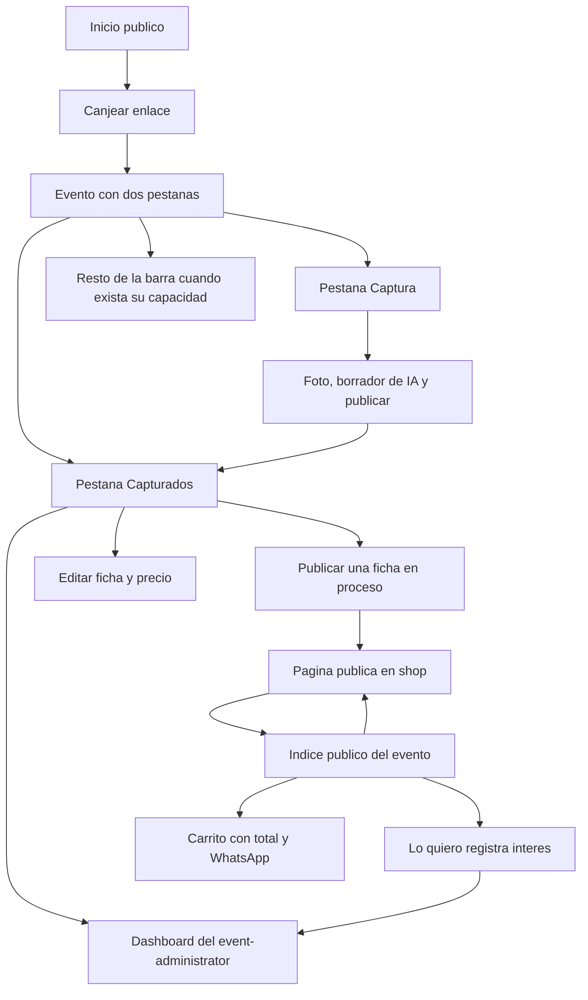

# Estructura de UI y navegación — evaluación del referente y base para MudanzApp

> **Naturaleza:** documento de evaluación y de decisión de presentación. **No amplía alcance**: no
> añade capacidades, rutas de producto ni endpoints. Fija la **forma** que tendrá la interfaz de
> `frontend` para que cada ciclo siguiente agregue una pantalla sin rehacer el marco.
> **Referente evaluado (solo lectura):**
> `../../../Wix-marketplace/ClickOnTheGoV1/frontend/src/app/`
> **Fuentes de alcance:** [`resumen-funcional`](../.plans/resumen-funcional-app-mudanzapp.md:64) §3 y §4;
> [`stack`](../.plans/stack-tecnologico-app-mudanzapp.md:41) §3; `decisiones` §20, §22, §24, §27 y §30.
> **Plan que lo consume primero:** [`plan-ciclo-3a-captura-articulo.md`](plan-ciclo-3a-captura-articulo.md:1).

## 1. Anatomía del referente

`ClickOnTheGoV1` es el mismo tipo de producto —un frontend privado de captura con sesión por
dispositivo— ya madurado, y su estructura es exactamente la que MudanzApp todavía no tiene. Así está
armada, por capas.

### 1.1 El marco vive en la raíz, no en una ruta

[`app.ts`](../../../Wix-marketplace/ClickOnTheGoV1/frontend/src/app/app.ts:72) es el componente
siempre montado y posee: la cabecera con marca, la navegación principal, el engrane de
configuración, el popover de cuenta, el contenedor del `router-outlet`, el host de toasts y el host
de onboarding. La navegación **no** se desmonta al cambiar de pantalla, que es lo que permite que
refleje estado sin parpadeos.

- Las entradas de la barra son un `computed` de tipo `Destination[]`
  ([`app.ts`](../../../Wix-marketplace/ClickOnTheGoV1/frontend/src/app/app.ts:85)): agregar una
  sección es agregar un objeto a un arreglo, no tocar la plantilla.
- La cabecera se oculta sin sesión
  ([`app.html`](../../../Wix-marketplace/ClickOnTheGoV1/frontend/src/app/app.html:2)): un
  dispositivo sin credencial solo puede canjear, y `/` ya ofrece esa entrada.
- Cada entrada lleva emoji decorativo (`aria-hidden`) y micro-etiqueta visible: la etiqueta es el
  nombre accesible.

### 1.2 Mapa de rutas con tres clases de pantalla

[`app.routes.ts`](../../../Wix-marketplace/ClickOnTheGoV1/frontend/src/app/app.routes.ts:30):

| Clase            | Ejemplos                                       | Regla                                                                                  |
| ---------------- | ---------------------------------------------- | -------------------------------------------------------------------------------------- |
| Marco público    | `/`                                            | Se abre **sin** sesión y sigue siendo útil: estado, dispositivo y «canjear invitación» |
| Pantalla pública | `/invite`                                      | El canje; también sin sesión, porque es la única puerta de entrada                     |
| Secciones        | `/capture`, `/drafts`, `/settings`, `/devices` | `loadComponent` (perezosas) + `requireSession`                                         |

`**` redirige a `/`. Las dos pantallas que deben funcionar **antes** de cualquier navegación quedan
ansiosas; el resto llega por chunk.

### 1.3 Sesión: una sola fuente, restaurada antes del router

- [`session.store.ts`](../../../Wix-marketplace/ClickOnTheGoV1/frontend/src/app/session/session.store.ts:17):
  una señal para la credencial, `hasSession` **derivada**, y `token()` como método —nunca una señal
  pública— para que ninguna plantilla pueda enlazarlo.
- [`credential-persistence.service.ts`](../../../Wix-marketplace/ClickOnTheGoV1/frontend/src/app/session/credential-persistence.service.ts:57):
  escribe `localStorage` **e** IndexedDB y lee el más reciente; un almacén que falla no rompe la
  operación.
- [`app.config.ts`](../../../Wix-marketplace/ClickOnTheGoV1/frontend/src/app/app.config.ts:26):
  `provideAppInitializer(() => inject(SessionStore).restore())`, de modo que una recarga con
  credencial en disco **no** se lea como «sin sesión» cuando el guard corre.
- [`session.guard.ts`](../../../Wix-marketplace/ClickOnTheGoV1/frontend/src/app/session/session.guard.ts:12):
  guard funcional, síncrono, que devuelve `router.createUrlTree(['/invite'])`.

### 1.4 El «nivel» como preferencia del dispositivo

[`level/app-mode.service.ts`](../../../Wix-marketplace/ClickOnTheGoV1/frontend/src/app/level/app-mode.service.ts:118)
guarda `basic | intermediate | advanced` en `localStorage` y expone señales derivadas
(`showsDrafts`, `showsImageEditor`, `forcesAutoApprove`). Cambia **qué se ofrece**, nunca un flujo ni
un endpoint; no viaja al servidor.

### 1.5 Primitivas de presentación y disciplina de error y prueba

- [`ui/ui-button`](../../../Wix-marketplace/ClickOnTheGoV1/frontend/src/app/ui/ui-button/ui-button.ts:24)
  exporta `uiButtonClasses()` para que un control que **no puede** ser `<button>` —el `<label>` que
  abre la cámara, porque solo un label activa un input de archivo de forma nativa— vista el mismo
  estilo sin repetirlo.
- `ui-card`, `ui-badge`, `ui-toast` + `ui-toast-host` completan el juego mínimo.
- [`session/api-error.ts`](../../../Wix-marketplace/ClickOnTheGoV1/frontend/src/app/session/api-error.ts:1)
  traduce `HttpErrorResponse` al **código estable**; las pantallas ramifican por `code`.
- Cada carpeta de pantalla lleva su `*.contract.ts` para las formas locales; lo que cruza la frontera
  HTTP vive en `shared`.
- Convención de `data-testid` (`shell-*`, `<pantalla>-*`) y specs junto a cada archivo, con dobles
  detrás de tokens (`QR_CODE_RENDERER`, `INVITE_SHARE`, `APP_MODE_STORE`, `CREDENTIAL_STORE`).

## 2. Lo que se adopta como base

Criterio: se adopta lo que **cuesta lo mismo ahora que después** y se vuelve caro de rehacer. Nada de
esto agrega funcionalidad; todo cambia la forma.

| #   | Base                                                                                   | Por qué compra esfuerzo                                                                                             | Dónde aterriza                                                                              |
| --- | -------------------------------------------------------------------------------------- | ------------------------------------------------------------------------------------------------------------------- | ------------------------------------------------------------------------------------------- |
| 1   | Marco persistente en la raíz, con la barra derivada de un `computed`                   | Agregar una sección después cuesta una entrada y una ruta, no una refactorización                                   | 3a: [`app.ts`](../frontend/src/app/app.ts:1) y [`app.html`](../frontend/src/app/app.html:1) |
| 2   | `/` público y útil + canje público + secciones con guard                               | Cualquier enlace profundo abierto sin sesión tiene dónde caer y una forma de entrar                                 | 3a                                                                                          |
| 3   | `SessionStore` + `restore()` en inicializador + guard + interceptor                    | Evita los dos defectos clásicos: la recarga tratada como «sin sesión» y el guard que adivina                        | 3a                                                                                          |
| 4   | `apiErrorCode()`                                                                       | La regla del stack ya dice que el cliente ramifica por `code`; sin el ayudante cada pantalla lo reinventa           | 3a                                                                                          |
| 5   | `ui-button` y `ui-card`, con `uiButtonClasses()` para `<label>`                        | La foto se toma con un `<label for>` sobre el input de archivo; un `<button>` estilizado no abre la cámara en móvil | 3a: campo de foto                                                                           |
| 6   | `loadComponent` para secciones                                                         | Gratis con una sección; con seis, la barra no paga el código que no abre                                            | 3a                                                                                          |
| 7   | Convención de `data-testid`                                                            | El e2e es la evidencia del ciclo; renombrar después obliga a reescribir pruebas                                     | 3a                                                                                          |
| 8   | `*.contract.ts` por pantalla solo para formas locales; contrato compartido en `shared` | Una sola fuente por hecho atravesando la frontera HTTP                                                              | Regla desde 3a                                                                              |
| 9   | Host de toasts fuera del outlet                                                        | Un resultado asíncrono debe sobrevivir al cambio de ruta                                                            | Diferido: disparador, el segundo consumidor                                                 |
| 10  | `withPreloading(PreloadAllModules)`                                                    | Evita la espera visible al primer clic cuando haya varias secciones                                                 | Diferido: disparador, dos secciones perezosas                                               |

## 3. Lo que no se copia, y por qué

| Rasgo del referente                                              | Por qué no entra                                                                                                                                                                                                                                           | Disparador que lo revisaría                                               |
| ---------------------------------------------------------------- | ---------------------------------------------------------------------------------------------------------------------------------------------------------------------------------------------------------------------------------------------------------- | ------------------------------------------------------------------------- |
| `AppModeService` con tres niveles de experiencia                 | No está declarado en el resumen funcional. Además el **nombre colisiona**: en MudanzApp `APP_MODE` es el modo de la integración primaria, no un nivel de interfaz. Si algún día se quiere un nivel, se llama distinto (`uiLevel`) y es su propia capacidad | Un ciclo que declare niveles de experiencia                               |
| Credencial redundante en IndexedDB                               | La decisión §27 fijó `localStorage` con CSP, scripts de terceros ausentes y sesiones revocables por dispositivo; sumar IndexedDB es una decisión nueva, no una mejora gratis                                                                               | Evicción real de `localStorage` en un webview o PWA                       |
| QR + huella comparada en voz alta                                | Nuestro enlace es acotado por tiempo y canjes (§30) y el riesgo es el reenvío, no el emparejamiento en campo cercano                                                                                                                                       | Incidente con un enlace reenviado, que ya es el disparador de §30         |
| Stream en vivo y avisos de publicación                           | El referente empuja a una cola de trabajos de Wix; MudanzApp no tiene cola ni trabajo en segundo plano                                                                                                                                                     | Un ciclo que introduzca un proceso asíncrono                              |
| Captura multi-foto con presign, miniatura y compresión en worker | Nuestro corte es una foto y un `PUT` binario contra el backend; importar ese pipeline es alcance nuevo y contradice la costura de almacenamiento de §26                                                                                                    | El ciclo de `publish` + R2 `live`, que es donde la foto se vuelve pública |
| Onboarding, splash, PWA, editor de imagen                        | No están declarados como capacidades                                                                                                                                                                                                                       | Su propia entrada en el resumen funcional                                 |

## 4. Mapa de navegación de MudanzApp

Regla: **un destino nace con su capacidad**. La barra se dibuja cuando hay dos o más destinos; hoy no
hace falta inventar entradas para pantallas que no existen.

| Ruta                                  | Superficie | Capacidad                                                                               | Ciclo       | Estado       |
| ------------------------------------- | ---------- | --------------------------------------------------------------------------------------- | ----------- | ------------ |
| `/`                                   | `frontend` | marco público: sesión, dispositivo, estado y entrada al canje                           | 3a          | se construye |
| `/invitacion?token=`                  | `frontend` | `invite`                                                                                | 3a          | se construye |
| `/eventos/:eventId`                   | `frontend` | `capture`: pestaña **Captura**                                                          | 3a y 3d     | se construye |
| `/eventos/:eventId/capturados`        | `frontend` | pestaña **Capturados**: los artículos con su estado                                     | 3d          | se construyó |
| `/eventos/:eventId/articulos/:itemId` | `frontend` | `item-edit`: edición de la ficha desde `Capturados`                                     | 4b          | se construyó |
| `/eventos/:eventId/dashboard`         | `frontend` | `event-admin`: panel con `Acceso` (co-dispositivos y enlaces) y `Capturas` (`Eliminar`) | 4c-2 a 4c-4 | se construyó |
| `/eventos`                            | `frontend` | `event-selector`: elección de la mudanza cuando la cuenta tiene varias                  | D2          | se construyó |
| `/:slug` del artículo                 | `shop`     | `publish` y `item-edit`: precio, snapshot y estado `Vendido`                            | 3c y 4b     | se construyó |
| `/evento/:publicSlug`                 | `shop`     | `event-index`: índice público del evento                                                | 4a          | se construyó |
| `/cuenta`                             | `shop`     | `shop-account`: acceso o registro del visitante y nombre opcional                       | 4d          | se construyó |
| `/auth/callback`                      | `shop`     | `shop-account`: vuelta pública del proveedor                                            | 4d          | se construyó |
| `/carrito/:publicSlug`                | `shop`     | `cart-request`: seleccionados, y `Pídelos por WhatsApp`                                 | 4e          | se construyó |
| cuenta y recordatorio 4/11/21         | `frontend` | `account-upgrade`                                                                       | 5           | no existe    |
| empaque, cotización y verificación    | `frontend` | `packing`, `quote-brief`, `receive-check`                                               | 6           | no existe    |

> **Nota (ciclo 3b):** `shop` existe como artefacto desde el ciclo 3b —workspace, puerto `4202` y
> Worker `mudanzapp-shop`— con `/` servido por el humo de estado. Las filas de `shop` quedaron en «no
> existe» porque describen **capacidades**: `publish` (3c) y `reserve` (4) —hoy `purchase_interest`
> (4e), decisión §38—. El mapa de rutas vigente de `shop` vive en
> [`shop/README.md`](../shop/README.md:1).
>
> **Nota (ciclo 3d):** la sección del evento pasa a tener **dos pestañas** —`Captura` y `Capturados`—
> servidas por dos rutas hijas del mismo marco. La pestaña es enlazable y el botón «atrás» del teléfono
> hace lo obvio; la barra **global** de [`app.ts`](../frontend/src/app/app.ts:1) no cambia, porque el
> destino de la aplicación sigue siendo el evento. La lista deja de convivir con el formulario y lleva
> el indicador `en proceso` | `publicado`, leído de `app.listing`. El detalle vive en
> [`plan-ciclo-3d`](plan-ciclo-3d-borrador-ia.md:163) §5.
>
> **Nota (ciclo 4):** el `shop` deja de ser una sola ruta y pasa a tener índice por evento
> (`/evento/:publicSlug`), ficha y carrito; el enlace del evento existe desde que el evento se crea y no
> depende de que haya artículos (decisión §36). En `frontend`, `Capturados` gana un botón `Editar` que
> abre la ruta de `item-edit`, y la sección del evento gana la ruta hija `dashboard`, reservada al
> event-administrator autenticado (decisión §37). El `shop` **no** gana catálogo global: `/` sigue
> siendo el humo del arranque.
>
> **Nota (ciclo 4a-fix):** la **Cuenta** del marco deja de ser solo el nombre del dispositivo y la
> salida: gana un card explicativo con el botón que emite una invitación para otro co-dispositivo, y con
> él el enlace de `event-index` se reparte sin volver al administrador. No hay ruta nueva: el card vive
> dentro del popover que ya existe y toma el `eventId` de la sesión (consecuencia de forma 4). La fila
> «cuenta y recordatorio 4/11/21» **no** cambia de ciclo: el card usa la capacidad `invite-device` del
> ciclo 2, no la pantalla de `account-upgrade`. El detalle vive en
> [`plan-ciclo-4a-correccion-cache-y-cuenta`](plan-ciclo-4a-correccion-cache-y-cuenta.md:1) §6.
>
> **Nota (ciclo 4b, cerrado el 2026-11-02):** `Capturados` gana el precio y el enlace `Editar` a
> `/eventos/:eventId/articulos/:itemId`; la fila publicada ofrece `Marcar vendido` con confirmación en
> dos toques y el estado `vendido` manda sobre `publicado`. En `shop`, la ficha pública se sirve como
> snapshot, pinta el precio con la moneda del evento y conserva `Vendido` con `noindex` durante la
> cortesía. El detalle vive en [`plan-ciclo-4b-item-edit`](plan-ciclo-4b-item-edit.md:1) §6; el dueño
> lo revisó `live` el 2026-11-02.
>
> **Nota (corte 4c-fix, 2026-11-04):** la revisión `live` de 4c-3 encontró tres enlaces del mismo día
> indistinguibles, así que el panel nombra cada enlace con una palabra de un anillo de 20 (decisión
> §42), pinta su emisión con **fecha y hora** y conserva 8 caracteres del `id` para depurar; el enlace
> la lleva como `?etiqueta=`. El detalle vive en
> [`plan-ciclo-4c-fix-etiqueta-enlaces`](plan-ciclo-4c-fix-etiqueta-enlaces.md:1); el dueño lo revisó
> `live` el 2026-11-04.
>
> **Nota (ciclo 4e, 2026-11-04):** el carrito deja de ser una ruta global y pasa a
> `/carrito/:publicSlug`: es **por evento**, porque el enlace del evento es la unidad que se comparte y
> la solicitud avisa al vendedor de ese evento. La ficha gana `Guardar en seleccionados` —fuera del
> `article` público, porque el snapshot no lo pinta— y el dashboard del evento gana el WhatsApp del
> vendedor y la lista de solicitudes, que es donde el aviso se lee. `4f` queda absorbido por este
> corte (decisión §44). El detalle vive en
> [`plan-ciclo-4e-carrito-seleccionados-whatsapp`](plan-ciclo-4e-carrito-seleccionados-whatsapp.md:1).
>
> **Nota (ciclo 4d, 2026-11-04):** `shop` gana `/cuenta` y la vuelta pública `/auth/callback`. La
> cuenta de la tienda es la misma cuenta OAuth del producto con una sesión de alcance `shop`; no abre
> el evento ni la identidad privada, y el nombre visible es opcional después del primer acceso
> (decisión §43). La barra de la shell ofrece ese acceso desde el enlace público del evento y desde la
> ficha, y vuelve a la misma página tras autenticarse; no crea interés ni abre el evento. `/` y el
> catálogo por evento no cambian. El detalle vive en
> [`plan-ciclo-4d-shop-account`](plan-ciclo-4d-shop-account.md:1).
>
> **Nota (corte D8, 2026-11-06):** la superficie privada deja de tener al evento como contenedor de
> la navegación. La barra inferior tiene tres destinos de nivel raíz —`/captura`, `/capturados` y
> `/cuenta`— y el evento se resuelve de la sesión. Las pantallas de detalle quedan fuera de la barra:
> `/articulos/:itemId` y `/dashboard`. Las rutas `/eventos/:eventId...` de la tabla se conservan como
> redirecciones a sus equivalentes raíz. `Cuenta` es una pantalla mínima en este corte: su contenido
> completo es D9 y la administración del evento dentro de ella es D10. El detalle vive en
> [`plan-ciclo-d8-shell-nav`](plan-ciclo-d8-shell-nav.md:1).
>
> **Nota (corte D9, 2026-11-06):** la Cuenta deja de ser la pantalla mínima de D8 y se completa en
> `/cuenta`: identidad y estado del dispositivo —cuenta vinculada o no y rol en la mudanza activa—,
> trayecto y enlace público del evento, vinculación de cuenta, invitación a otro dispositivo, canje de
> otra invitación y cierre de sesión. No hay ruta nueva ni cambio de guardas: la administración del
> evento sigue siendo `/dashboard` y su traslado dentro de la Cuenta es D10. El detalle vive en
> [`plan-ciclo-d9-cuenta-ruta`](plan-ciclo-d9-cuenta-ruta.md:1).
>
> **Nota (corte D10, 2026-11-07):** la administración del evento deja de ser una ruta hermana y pasa a
> ser hija de la Cuenta en `/cuenta/evento`, con `requireSession` heredado del padre y
> `requireEventAdmin` en la hija. La Cuenta enlaza a ella y es la pantalla que enseña el rechazo de un
> co-dispositivo; `Capturados` deja de montar ese aviso. `/dashboard` y
> `/eventos/:eventId/dashboard` se conservan como redirecciones. El contenido del panel
> —co-dispositivos, enlaces, solicitudes y capturas— no cambia. El detalle vive en
> [`plan-ciclo-d10-cuenta-evento`](plan-ciclo-d10-cuenta-evento.md:1).
>
> **Nota (corte D11, 2026-11-07):** la administración del evento se lee por secciones. `/cuenta/evento`
> publica una tira con cuatro pestañas —`Artículos`, `Solicitudes`, `Invitaciones` y
> `Otros dispositivos`—, en ese orden y con `Artículos` abierta por defecto; solo la activa monta su
> lista, y cada una conserva su lectura, su estado vacío y su acto. La configuración del evento
> —trayecto, enlace público, quién administra y WhatsApp— queda fija arriba, fuera de las pestañas. La
> pestaña es estado en memoria, no ruta: la URL sigue siendo `/cuenta/evento` y recargar vuelve a
> `Artículos`. Sin backend, sin contrato ni migración. El detalle vive en
> [`plan-ciclo-d11-pestanas-panel-evento`](plan-ciclo-d11-pestanas-panel-evento.md:1).
>
> **Nota (corte D2, 2026-11-07):** la cuenta con dos o más membresías deja de aterrizar en la más
> reciente. `/eventos` es el selector: publica la lista de membresías con su trayecto y su rol, y
> `requireEventChoice` devuelve ahí a los destinos privados —`/captura`, `/capturados`,
> `/articulos/:itemId` y `/cuenta/evento`— mientras no haya una elección explícita. El evento activo
> es la elección, o la única membresía; con varias y sin elección no hay evento activo. La elección
> vive en memoria mientras dura la visita (persistirla es una decisión propia), la Cuenta enlaza al
> selector y la barra marca `Cuenta` en `/eventos`. El detalle vive en
> [`plan-ciclo-d2-selector-evento`](plan-ciclo-d2-selector-evento.md:1).

Consecuencias de forma:

1. **`/` deja de ser el humo de estado y pasa a ser el marco.** El [`status.component`](../frontend/src/app/status/status.component.ts:13)
   existente se conserva dentro del marco, como en el referente
   ([`shell.component.html`](../../../Wix-marketplace/ClickOnTheGoV1/frontend/src/app/shell/shell.component.html:40)).
2. **El enlace de invitación es una pantalla, no un token en la URL de sesión.** El token de la
   invitación sí viaja en el enlace —es la capacidad—; el de sesión nunca, como ya fija §22.
3. **El evento es la sección operativa**, no una pestaña por evento: la ruta lleva su `eventId` y el
   guard exige sesión. Un co-dispositivo con sesión de un evento entra directo a su evento.
4. **La cuenta del marco** muestra el estado del dispositivo, la acción de vincular cuenta —cuando
   exista, ciclo de `account-link`— y cerrar sesión local.
5. **El `dashboard` es una ruta hija del evento**, no una superficie nueva: la barra global no cambia y
   el guard exige una sesión de cuenta cuyo usuario sea el event-administrator reclamado (decisión §37).
   Una sesión de co-dispositivo no entra, y su rechazo es la evidencia de seguridad del corte 4c.

## 5. Qué construye el ciclo 3a de esta base

| Pieza                                  | Archivo                                                                                | Justificación |
| -------------------------------------- | -------------------------------------------------------------------------------------- | ------------- |
| Marco con cabecera y barra condicional | [`app.ts`](../frontend/src/app/app.ts:1), [`app.html`](../frontend/src/app/app.html:1) | Base #1       |
| Inicio público                         | `frontend/src/app/home/home.component.*`                                               | Base #2       |
| Canje                                  | `frontend/src/app/session/redeem.component.*`                                          | Base #2       |
| Sección del evento                     | `frontend/src/app/events/event.component.*` (perezosa)                                 | Bases #2 y #6 |
| Sesión, guard e interceptor            | `frontend/src/app/session/session.store.ts`, `session.guard.ts`, `auth.interceptor.ts` | Base #3       |
| Traducción de errores                  | `frontend/src/app/session/api-error.ts`                                                | Base #4       |
| Primitivas                             | `frontend/src/app/ui/ui-button/*`, `frontend/src/app/ui/ui-card/*`                     | Base #5       |
| Captura                                | `frontend/src/app/items/item-form.component.*` con `<label for>` + input oculto        | Base #5       |

Deliberadamente fuera de 3a: host de toasts (base #9), precarga (base #10), niveles de experiencia,
IndexedDB, QR, stream y onboarding.

## 6. Costo declarado

- Una pantalla nueva de inicio que hoy solo muestra estado de sesión y el humo de `/health`; no
  introduce ninguna capacidad.
- Cuatro archivos de base que el ciclo 3a necesitaba de todos modos (`session.store`, `session.guard`,
  `auth.interceptor`, `api-error`) más dos primitivas de presentación.
- El plan de 3a cambia la forma de sus rutas: `/` inicio, `/invitacion?token=` y
  `/eventos/:eventId` con guard. Los `data-testid` se fijan desde el primer corte.
- Nada de esto toca `backend`, `shared` ni la base de datos.
