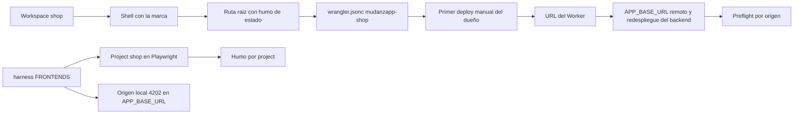

# Plan del ciclo 3b — bootstrap de `shop`, el tercer frontend

> **Estado:** propuesto para aprobación del dueño. Es el corte 2 del ciclo 3 según
> [`plan-ciclo-3a-captura-articulo.md`](plan-ciclo-3a-captura-articulo.md:367) §13.
> **Fuentes:** `resumen-funcional` §1 y §3 (fila 3b); [`stack`](../.plans/stack-tecnologico-app-mudanzapp.md:29)
> §1 y §3; `decisiones` §19 (revisión), §20, §28; [`07-bootstrap`](../.guidelines/07-bootstrap-y-entrega-verificada.md:1)
> §1, §4, §5 y §6; [`04-verificacion`](../.roo/rules/04-verificacion.md:1);
> [`06-datos`](../.roo/rules/06-datos.md:1) y [`07-secretos`](../.roo/rules/07-secretos.md:1).
> **Hipótesis del ciclo:** «el tercer frontend se despliega y se enruta igual que los otros dos».

## 1. Hipótesis y corte

- **Hipótesis de 3b:** un tercer frontend público —`shop`— existe como workspace del monorepo, se
  construye con el mismo contrato que `frontend` y `wiki`, abre desde su Worker y su origen entra en
  la allowlist del backend sin tocar el código del backend.
- **Corte vertical:** workspace → shell con la marca → ruta `/` con el humo de estado → `wrangler.jsonc`
  con su Worker → `project` en el arnés → origen local en `APP_BASE_URL` → los dos hechos remotos del
  dueño (primer deploy del Worker y redespliegue del backend).
- **Superficie:** `shop` (workspace completo), la raíz (`package.json`, `eslint.config.js`), el arnés
  ([`harness.ts`](../e2e/support/harness.ts:44)) y la documentación de estado. **No** toca `backend`,
  `shared`, el esquema, `frontend` ni `wiki`.
- **Qué compra:** el hecho que `publish` (3c) necesita para no mezclar infraestructura con producto.
  El stack declara hoy una superficie **sin artefacto**; 3b retira esa nota y la convierte en un
  tercer artefacto desplegable.
- **Qué no compra:** nada de catálogo. No hay artículo publicado, ni URL por artículo, ni foto
  pública, ni indexación de contenido. La ruta `/` es el humo del arranque, no una pantalla de
  producto.
- **Por qué no es `publish`:** `publish` exige `app.listing`, la lectura pública de la foto, R2 `live`,
  el slug por artículo y la decisión §26. Eso es producto sobre una superficie que hoy no existe; 3b
  crea la superficie y su evidencia es de arranque (`07` §2 y §8).



## 2. Fuera del ciclo

- `publish`: `app.listing`, slug por artículo, URL pública legible, indexación de contenido, tarjeta de
  vista previa (decisión §28) y sitemap.
- Lectura pública de fotos y su retención (decisión §26): se ejercen en 3c junto con R2 `live`.
- Catálogo, navegación, apartado y compra (ciclo 4). Sesión de alcance `shop`: el valor existe en
  `app.session.scope` desde el ciclo 1, pero este corte **no** la ejerce, no la emite y no la consume.
- Cualquier formulario, listado o llamada del visitante que no sea el humo de `/health`.
- Extracción de un paquete de UI compartido entre las tres superficies: tres shells de arranque no
  justifican una abstracción (`.guidelines/03`).
- i18n, SEO por ruta, metadatos social y `robots.txt`.
- Cambios en el backend: rutas, CORS, configuración, errores y esquema **no cambian**. El origen nuevo
  entra por variable de entorno, no por código (`decisiones` §19).
- La sección 3 del dossier en `wiki` (contrato de la IA): su hecho es 3d.

## 3. Hechos que este plan resuelve

`shop` no arrastra hechos de dueño bloqueantes —no toca identidad, dinero, IA ni datos— pero sí tres
decisiones locales que conviene fijar antes de escribir código.

| Hecho                      | Resolución de 3b                                                                                                                                                                                | Costo declarado                                                                                                                                                                                                   |
| -------------------------- | ----------------------------------------------------------------------------------------------------------------------------------------------------------------------------------------------- | ----------------------------------------------------------------------------------------------------------------------------------------------------------------------------------------------------------------- |
| **Nombre del Worker**      | `mudanzapp-shop`, derivado de la regla del generador: el primero toma el slug, el resto `slug-fe`. Es el del `name` de `wrangler.jsonc` y el del dashboard, y se declara una sola vez (`07` §6) | El dueño confirma que el nombre está libre en Cloudflare antes del primer deploy                                                                                                                                  |
| **Puerto de desarrollo**   | `4202`. `4200` es `frontend`, `4201` es `wiki`; el arnés posee los cuatro puertos con el backend en `3000`                                                                                      | Un terminal más en el dev loop manual; el arnés levanta un `ng serve` más                                                                                                                                         |
| **Primera ruta de `shop`** | `/` renderiza `StatusComponent`, igual que `wiki`: es el walking skeleton y la prueba de que el Worker sirve la shell y el backend responde cross-origin                                        | Una superficie pública y **indexable** muestra temporalmente el estado del proceso y de la base; se sustituye en 3c, cuando exista la primera página publicada. Se registra como estado aceptado, no como defecto |
| **`APP_BASE_URL` local**   | Automático: [`backendEnv()`](../e2e/support/harness.ts:90) compone la allowlist a partir de `FRONTENDS`, así que el origen `http://localhost:4202` entra sin editar una lista aparte            | Ninguno; es la misma fuente única que ya usan los otros dos                                                                                                                                                       |
| **`APP_BASE_URL` remoto**  | Pendiente del deploy: el valor solo existe después de `Man-3.5` y se aplica en `Man-3.6` con un redespliegue del backend                                                                        | El estado intermedio «la shell se ve, `/health` lo bloquea el navegador» es esperado (`decisiones` §19)                                                                                                           |
| **Dependencias**           | Ninguna nueva. El workspace reusa las versiones ya instaladas por `frontend` y `wiki`; no hay commit `deps`                                                                                     | Ninguno                                                                                                                                                                                                           |
| **Snapshot de nombres**    | [`.scripts/workspace-params.*`](../.scripts/README.md:23) **no** se regenera: está congelado desde el primer bring-up                                                                           | El hecho nuevo se anota en [`workspace-env.md`](../.scripts/workspace-env.md:46) §5, que es su fuente viva                                                                                                        |

## 4. Cambios por archivo

### `shop/` — workspace nuevo (misma forma que `wiki`, sin features)

Se copia la forma técnica, no las pantallas: cada frontend tiene su `angular.json`, su
`wrangler.jsonc` y su puerto (decisión §2 de la plantilla). Archivos:

| Archivo                                                                   | Contenido                                                                                                                                                                             |
| ------------------------------------------------------------------------- | ------------------------------------------------------------------------------------------------------------------------------------------------------------------------------------- |
| [`shop/package.json`](../shop/package.json:1)                             | `@mudanzapp/shop`, mismos scripts que `wiki` con `--frontend shop` en `brand:index`                                                                                                   |
| [`shop/angular.json`](../shop/angular.json:1)                             | Proyecto `shop`; `build`, `serve` con `proxyConfig` y `test` con `runnerConfig`; presupuestos de arranque iguales a `wiki`                                                            |
| `shop/tsconfig.json`, `shop/tsconfig.app.json`, `shop/tsconfig.spec.json` | Copia de los de `wiki`; strict y `types` iguales                                                                                                                                      |
| [`shop/vitest.config.ts`](../shop/vitest.config.ts:1)                     | `globals: true`, `pool: 'threads'`                                                                                                                                                    |
| `shop/.postcssrc.json`                                                    | `@tailwindcss/postcss` como único plugin                                                                                                                                              |
| [`shop/proxy.conf.json`](../shop/proxy.conf.json:1)                       | `/api` → `http://localhost:3000` con `pathRewrite`                                                                                                                                    |
| `shop/src/index.html`                                                     | `<title>` **vacío**; la marca entra al artefacto con `brand:index`                                                                                                                    |
| `shop/src/styles.css`                                                     | `@import 'tailwindcss'` y [`theme.css`](../shared/src/theme.css:1) de `shared`                                                                                                        |
| `shop/src/main.ts`                                                        | `bootstrapApplication(App, appConfig)`                                                                                                                                                |
| `shop/src/environments/environment.ts`                                    | `{ apiBaseUrl: '/api' }`                                                                                                                                                              |
| `shop/src/environments/environment.production.ts`                         | El `⟨BACKEND_HOST⟩` ya observado en [`workspace-env.md`](../.scripts/workspace-env.md:56) §5, sin barra final; se compila                                                             |
| `shop/src/app/api-base-url.token.ts`                                      | El token `API_BASE_URL`                                                                                                                                                               |
| [`shop/src/app/app.config.ts`](../shop/src/app/app.config.ts:1)           | `provideBrowserGlobalErrorListeners`, `provideRouter`, token con el valor compilado                                                                                                   |
| [`shop/src/app/app.routes.ts`](../shop/src/app/app.routes.ts:1)           | `''` → `StatusComponent`; `'**'` → `''`                                                                                                                                               |
| `shop/src/app/app.ts`, `app.html`, `app.spec.ts`                          | Shell mínimo con la marca; el título del documento sale de `shared/src/brand.json`                                                                                                    |
| `shop/src/app/status/*`                                                   | `StatusComponent` y su spec, con `data-testid` `status-process` y `status-database`                                                                                                   |
| [`shop/public/favicon.svg`](../shop/public/favicon.svg:1)                 | Favicon propio en texto: las herramientas de edición no escriben binarios. Se puede sustituir por el `.ico` de `frontend` copiándolo y ajustando el `<link rel="icon">`               |
| `shop/README.md`                                                          | Mapa de rutas vigente (hoy **una**), puerto, scripts y el aviso de que el arnés es Playwright, no `ng e2e`                                                                            |
| [`shop/wrangler.jsonc`](../shop/wrangler.jsonc:1)                         | `name: "mudanzapp-shop"`, `compatibility_date` `2026-10-06`, `assets.directory` `./dist/shop/browser`, `not_found_handling: "single-page-application"`; sin `main` y sin `_redirects` |

### Raíz

- [`package.json`](../package.json:10): `shop` entra en `workspaces`; alias nuevos
  `dev:web:shop`, `build:web:shop` y `test:web:shop` con la misma forma que los de `wiki`. El
  lockfile se regenera con `npm install` (paso manual del dueño, no una edición a mano).
- [`eslint.config.js`](../eslint.config.js:8): `shop/**/*.ts` y `shop/**/*.html` entran en
  `angularFrontends` y `angularTemplates`; sin eso, el tercer frontend queda fuera de las reglas de
  Angular y la pasada única deja de ser única.

### Arnés

- [`e2e/support/harness.ts`](../e2e/support/harness.ts:44): tercera entrada de `FRONTENDS`
  (`name: 'shop'`, `port: 4202`, `command: 'npm run dev -w shop -- --port 4202'`) y comentario del
  puerto actualizado. `HARNESS_PORTS` y `APP_BASE_URL` se derivan de ahí: no se editan aparte.
- [`e2e/playwright.config.ts`](../e2e/playwright.config.ts:32) **no** cambia: ya mapea `FRONTENDS` a
  `projects` y a un `webServer` por frontend.
- [`e2e/smoke.spec.ts`](../e2e/smoke.spec.ts:10) **no** cambia: corre una vez por `project`, así que
  el humo de `shop` es evidencia nueva sin tocar la spec.
- [`e2e/capture.spec.ts`](../e2e/capture.spec.ts:75) e [`identity.spec.ts`](../e2e/identity.spec.ts:31)
  **no** cambian: ya se saltan en cualquier `project` que no sea `frontend`.

### Documentación de estado

Ninguna de estas filas amplía alcance: corrigen el estado declarado de una superficie que deja de ser
la tercera «sin artefacto».

| Archivo                                                                 | Cambio                                                                                                                                           |
| ----------------------------------------------------------------------- | ------------------------------------------------------------------------------------------------------------------------------------------------ |
| [`README.md`](../README.md:5) §1                                        | Fila `shop/` en la tabla de directorios; se retira la nota de «declarada y sin artefacto»                                                        |
| [`README.md`](../README.md:136) §5                                      | Terminal 5 del dev loop: `npm run dev:web:shop` en `4202`                                                                                        |
| [`README.md`](../README.md:154) §6                                      | Alias `dev`/`build`/`test` de `shop` en el contrato de scripts                                                                                   |
| [`README.md`](../README.md:271) §10                                     | Puertos del arnés: `3000`, `4200`, `4201`, `4202`                                                                                                |
| [`README.md`](../README.md:327) §12                                     | Un Worker por frontend pasa a tres; mismos comandos, mismo contrato                                                                              |
| [`stack`](../.plans/stack-tecnologico-app-mudanzapp.md:29) §1 y §3      | `shop` pasa de «declarada y sin artefacto» a «existe como workspace» con su Worker                                                               |
| `resumen-funcional` §1                                                  | La línea de estado de las superficies refleja que las tres existen                                                                               |
| `decisiones` §19 y §20                                                  | Revisión fechada: el disparador se cumple, el origen de `shop` entra en `APP_BASE_URL` y el mapa del arnés; se registra lo observado             |
| [`00-stack.md`](../.roo/rules/00-stack.md:10)                           | La lista de workspaces incluye `shop`; se retira «sin workspace hasta su ciclo de bootstrap»                                                     |
| [`wiki/README.md`](../wiki/README.md:38)                                | La nota de `shop` como superficie que todavía no existe se retira                                                                                |
| [`estructura-ui-navegacion`](estructura-ui-navegacion-mudanzapp.md:122) | La fila de `shop` deja de decir «no existe»: `/` existe como humo y el crecimiento de rutas empieza en 3c                                        |
| [`workspace-env.md`](../.scripts/workspace-env.md:46) §5                | Tras el deploy, la fila del Worker `mudanzapp-shop` con su URL observada y el valor de `APP_BASE_URL`. Es la fuente viva; el snapshot no se toca |

## 5. Contrato resultante

| Pieza                 | Valor                                               | Quién lo posee                                         |
| --------------------- | --------------------------------------------------- | ------------------------------------------------------ |
| Paquete               | `@mudanzapp/shop` en `shop/`                        | `/package.json` `workspaces`                           |
| Puerto de desarrollo  | `4202`                                              | Alias de la raíz y `harness.ts`                        |
| Worker                | `mudanzapp-shop`                                    | `shop/wrangler.jsonc` y el dashboard (deben coincidir) |
| Build                 | `npm run build:web:shop` → `dist/shop/browser`      | Alias de la raíz                                       |
| Deploy                | `npx wrangler deploy -c shop/wrangler.jsonc`        | `Man-3.5` (dueño)                                      |
| Origen en CORS local  | `http://localhost:4202`                             | Derivado de `FRONTENDS`                                |
| Origen en CORS remoto | La URL del Worker, junto a los otros dos            | `Man-3.6` (dueño)                                      |
| Rutas de `shop`       | `/` con el humo; `**` → `/`                         | `shop/src/app/app.routes.ts`                           |
| Contrato HTTP         | **Sin cambios**: ni rutas nuevas, ni códigos nuevos | —                                                      |
| Esquema               | **Sin cambios**: 3b no migra nada                   | —                                                      |

## 6. Evidencia

### Unit — `shop`

- `shop/src/app/app.spec.ts`: la shell pinta el nombre público de `shared` y fija el título del
  documento desde la misma fuente.
- `shop/src/app/status/status.component.spec.ts`: el humo expone los estados y no cablea el origen.

### e2e — sin spec nueva

- El humo existente corre una vez por `project`: abre `http://localhost:4202` y exige
  `status-process` = `ok` y `status-database` = `ok` en el DOM real, con el valor observado como
  evidencia anotada.
- Las suites de captura e identidad siguen saltándose fuera de `frontend`: el corte no las toca.

### Build y contrato del Worker

- `npm run build:web:shop` emite `dist/shop/browser/index.html` con el título de marca ya escrito por
  `brand:index`, y el CSS de Tailwind aplicado.
- `npx wrangler deploy --dry-run -c shop/wrangler.jsonc` valida el `wrangler.jsonc` y el
  `assets.directory` sin publicar (evidencia opcional; el primer deploy real es del dueño).

### Evidencia observada (2026-10-31, corrida local, un comando por invocación)

| Comprobación                | Resultado                                                                           |
| --------------------------- | ----------------------------------------------------------------------------------- |
| `npm run typecheck`         | verde, con `@mudanzapp/shop` incluido                                               |
| `npm run lint`              | verde                                                                               |
| `npm run format:check`      | verde tras `npm run format` (los archivos nuevos entraban sin normalizar)           |
| `npm run test:web:shop`     | 2 archivos, 3 pruebas                                                               |
| `npm run build:web:shop`    | 690.49 kB iniciales: aviso de 500 kB superado, error de 1 MB no                     |
| `npm run typecheck:e2e`     | verde                                                                               |
| `npm run test:e2e`          | 12 pruebas: 6 pasan y 6 se saltan; `observed shop {"process":"ok","database":"ok"}` |
| `wrangler deploy --dry-run` | válido: lee los 4 archivos de `shop/dist/shop/browser`, sin bindings                |

## 7. Gate

Proporcional al corte: es un bootstrap de frontend, no toca base ni backend. Un comando por
invocación, una corrida a la vez.

```
npm install
npm run typecheck
npm run lint
npm run format:check
npm run test:web:shop
npm run build:web:shop
npm run typecheck:e2e
npm run db:migrate:test          # a mano y solo si faltara el esquema de 3a en la base de pruebas
npm run test:e2e
```

- `test:api` y `test:api:db:*` **no** son del corte: el backend no cambia. Si el dueño quiere
  cerrar con la dev branch, `npm run test:e2e:branch` es equivalente y exige
  `npm run db:migrate:branch:test` antes.
- El arnés **no** migra: si el esquema falta, falla ruidosamente y no se salta.
- La verificación remota **no** es gate: ocurre cuando el dueño ejecuta `Man-3.5` y `Man-3.6`, y se
  cierra con el commit que anota los valores observados.

## 8. Commit

```
feat(web): bootstrap the public shop workspace and worker
```

Cuerpo: hipótesis, corte y evidencia local (sin secretos y sin URLs de entorno). El hecho remoto se
cierra aparte, con el commit que anota los valores observados en `workspace-env.md` §5.

## 9. Riesgos y disparadores

- **`/` público muestra el estado del proceso y de la base.** Es un artefacto de arranque, no una
  pantalla de producto, y las tres superficies comparten esa deuda. Disparador: 3c, que sustituye `/`
  por la primera página publicada.
- **Tres `ng serve` en el arnés.** La corrida crece en puertos y en tiempo, y un dev loop levantado
  hace fallar el arnés con `e2e-port-in-use`. Es el comportamiento correcto (`07` §4); se documenta el
  puerto nuevo en el `README` y en `shop/README.md`.
- **Shell duplicado en tres workspaces.** Aceptado: tres shells de arranque no compran una
  abstracción. Disparador: la primera pantalla que se repita con lógica propia en dos superficies.
- **El bundle inicial de `shop` supera el aviso de presupuesto.** Medido en 690.49 kB con el aviso en
  500 kB y el error en 1 MB; es el mismo hecho que `frontend` (746 kB). No rompe el gate. Disparador:
  antes de `publish`, medir el chunk y decidir entre subir el presupuesto o mover a perezoso lo que no
  hace falta en el primer render.
- **El Worker no existe hasta que el dueño lo crea.** El build local no lo prueba; entre el commit y
  el primer deploy la hipótesis queda abierta a propósito.
- **Estado intermedio de CORS.** Con `APP_BASE_URL` sin el origen de `shop`, el navegador bloquea
  `/health` en su URL. Se resuelve en `Man-3.6` con un redespliegue del backend; no es un defecto del
  código (`decisiones` §19).
- **El snapshot de nombres queda desactualizado a propósito.** No se regenera porque está congelado;
  el hecho nuevo vive en `workspace-env.md` §5.
- **Sin binding de Worker ni variables de Worker.** `shop` no lee secretos: su origen de backend se
  compila como en los otros dos.

## 10. Alternativas de corte evaluadas

| Corte                                                          | Qué aprende                                                                       | Costo                                                                                 | Veredicto                                                    |
| -------------------------------------------------------------- | --------------------------------------------------------------------------------- | ------------------------------------------------------------------------------------- | ------------------------------------------------------------ |
| **3b — bootstrap de `shop` como tercer artefacto desplegable** | El tercer frontend se construye, se enruta y se despliega igual que los otros dos | Un workspace nuevo y dos hechos remotos del dueño                                     | **Recomendado**                                              |
| Fusionar 3b con 3c (`publish` + R2 `live`)                     | La hipótesis completa del ciclo 3 en un ciclo                                     | Infraestructura y producto en una sola evidencia; un rollback arrastra las dos cosas  | Descartado: `plan-ciclo-3a` §13 ya declaró el costo          |
| Landing mínima pública en `/` en vez del humo                  | Una primera impresión de marca                                                    | Sin evidencia de contrato: el humo es lo que demuestra build, Worker y CORS (`07` §2) | Descartado como corte; queda como decisión abierta del dueño |
| Adelantar el catálogo para que `shop` tenga algo que mostrar   | Navegación pública                                                                | Catálogo antes de `publish`: no hay página que navegar                                | Descartado                                                   |
| Extraer un paquete de UI compartido para las tres superficies  | Una sola shell                                                                    | Abstracción sin segunda pantalla que la justifique                                    | Descartado (`.guidelines/03`)                                |

## 11. Orden de implementación

1. Declarar el estado del corte en `resumen-funcional` §1, `stack` §1 y §3 (sin código).
2. Workspace `shop`: `package.json`, `angular.json`, `tsconfig*`, `vitest.config.ts`,
   `.postcssrc.json` y `proxy.conf.json`.
3. Shell: `index.html` vacío, `styles.css`, `main.ts`, `environments`, token, `app.config`,
   `app.routes`, `app.ts`/`app.html` y `StatusComponent` con sus specs.
4. `wrangler.jsonc` con `mudanzapp-shop` y el `assets.directory` correcto.
5. Raíz: `workspaces` y los tres alias; `shop` en `eslint.config.js`.
6. Arnés: tercera entrada de `FRONTENDS` y comentario del puerto.
7. `shop/README.md` con el mapa de rutas vigente.
8. Documentación de estado (`README` §1, §5, §6, §10 y §12; `decisiones` §19 y §20; `00-stack`;
   `wiki/README`; `estructura-ui`).
9. `npm install` y gate local completo; commit `feat(web)`.
10. Hechos remotos del dueño (`Man-3.5` y `Man-3.6`) y commit que anota los valores observados.

## 12. Lo que el dueño hace a mano

El modo que implementa solo edita archivos: no crea ramas, no instala y no despliega.

### Antes de pedirle a Code que implemente

1. **Cerrar 3a.** El ciclo anterior debe estar validado y commiteado
   (`feat(api): capture the first article with a photo`) y `git status` limpio en `main`. 3b hereda
   ese árbol; si 3a sigue abierto, el baseline no es estable y el gate de 3b mide dos cosas.
2. **Crear la rama de git del ciclo.** `main` está protegida y no es sandbox (`decisiones` §9).
   Recomendación: `feat/shop-bootstrap` desde `main`, integrada **solo** con el gate verde. Es una
   decisión del dueño, no del modo que implementa, y se toma antes del paso 1 del orden anterior.
3. **Confirmar que el nombre del Worker está libre.** En el dashboard de Cloudflare, ningún Worker
   llamado `mudanzapp-shop`. El `name` del `wrangler.jsonc` y el del dashboard deben coincidir o el
   build falla (`07` §6).
4. **Confirmar que el puerto `4202` está libre** en la máquina. El resto (`4200`, `4201`, `3000`) ya
   son del arnés.
5. **Confirmar los accesos que el ciclo necesitará después:** Cloudflare con la GitHub App autorizada
   (para `Man-3.5`) y el dashboard de Railway del backend (para `Man-3.6` y el redespliegue). Si
   faltan, el ciclo puede cerrar en local pero su hipótesis queda abierta.
6. **Confirmar el esquema de la base de pruebas.** El arnés no migra: `mudanzapp_test` debe tener el
   esquema de 3a (`app.item`). Si no lo tiene, corre `npm run db:migrate:test` antes del gate; si vas
   a cerrar con la dev branch, `npm run db:migrate:branch:test`.
7. **Decidir la primera ruta de `shop`.** Se propone el humo de estado en `/` (walking skeleton,
   igual que `wiki`), que es público e indexable mientras dura el arranque. La alternativa —una
   landing mínima— cuesta una pantalla de producto en un ciclo de infraestructura.
8. **No hace falta aprobar dependencias.** 3b no añade ninguna de runtime; si apareciera una, el
   ciclo se detiene y se abre su propio commit `deps`.

### Después de que Code entregue los archivos

1. `npm install` en la raíz: enlaza el tercer workspace y regenera el lockfile.
2. El gate de §7, un comando por invocación, sin dev loop levantado en `3000`, `4200`, `4201` ni
   `4202`.
3. Commit `feat(web)` con la evidencia local.
4. `Man-3.5`: crear el Worker `mudanzapp-shop`, conectarlo al repositorio en `main`, build
   `npm run build:web:shop`, deploy `npx wrangler deploy -c shop/wrangler.jsonc`, `NODE_VERSION`, y
   anotar la URL.
5. `Man-3.6`: `APP_BASE_URL` con los **tres** orígenes, redespliegue del backend, preflight `OPTIONS`
   con el origen de `shop` → `204`.
6. Commit que anota los valores observados en [`workspace-env.md`](../.scripts/workspace-env.md:46)
   §5 y la revisión de `decisiones` §19 y §20. Nunca credenciales.

## 13. Rama, base y entrega

- **Dev branch de base de datos:** no se crea ni se toca. Es única y estable; 3b no cambia el esquema,
  así que el ciclo ni siquiera necesita aplicarla.
- **Rama de git:** corta, por ciclo, desde `main`, integrada con el gate verde (§12.2).
- **Cierre:** el commit convencional de §8, más el commit del hecho remoto. Sin gate verde no hay
  integración; lo no validado se queda en la rama del ciclo (`02-commits`).
- **Sin CI:** los Workers Builds despliegan desde `main`, así que el primer deploy del Worker ocurre
  **después** de integrar el commit localmente validado.
