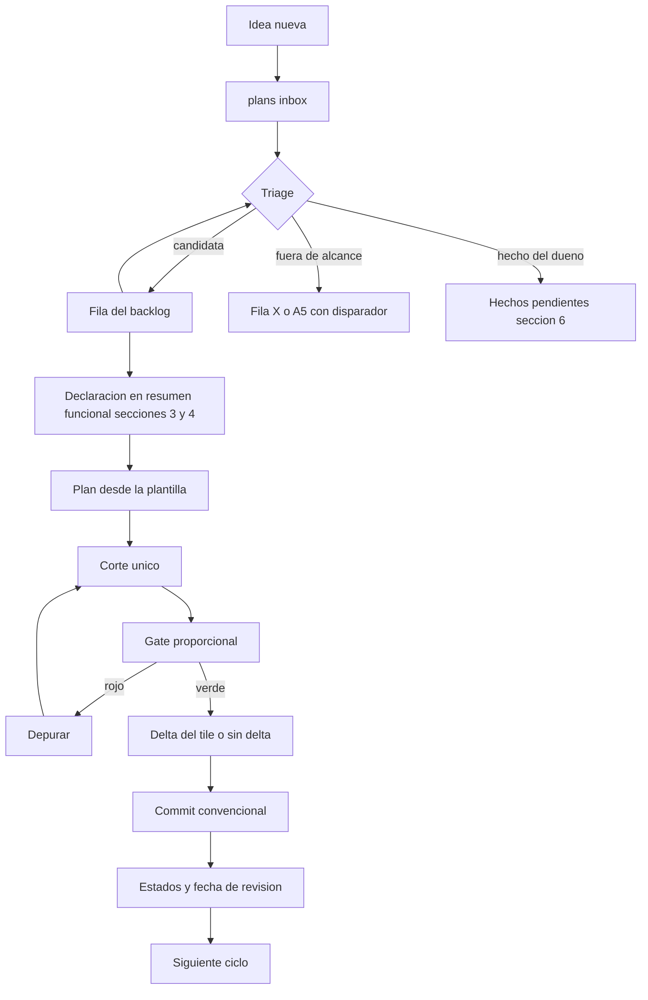

# Workflow de ciclos — abrir, ejecutar y cerrar una funcionalidad

> **Rol:** procedimiento operativo del ciclo 0 → 1. Normativo por referencia:
> [`01-scope`](../.roo/rules/01-scope.md:1) fija la obligación y este archivo fija el orden. No crea
> alcance, no deroga lineamientos y no autoriza construir nada.
> **Dueño:** Architect. **Revisión:** dueño del proyecto. **Fecha:** 2026-11-06.
> **Se lee:** al abrir y al cerrar un ciclo; no a mitad de una implementación.
> **No duplica:** [`01-scope`](../.roo/rules/01-scope.md:1), [`02-commits`](../.roo/rules/02-commits.md:1),
> [`04-verificacion`](../.roo/rules/04-verificacion.md:1), [`05-deps`](../.roo/rules/05-deps.md:1),
> [`06-datos`](../.roo/rules/06-datos.md:1), [`wiki-delta`](../.plans/wiki-delta.md:1) y
> [`06`](../.guidelines/06-entrega-y-evidencia.md:1). Si hay conflicto, manda la fuente citada.

## 0. Qué resuelve y qué no

Las obligaciones de un ciclo existen y están escritas, pero dispersas en siete archivos y en el orden
en que cada uno las pensó. Este documento las pone en **un solo recorrido**: idea → declaración →
plan → corte → evidencia → wiki → commit → estado.

No hace lo siguiente:

- No define alcance: eso sigue siendo [`resumen-funcional`](../.plans/resumen-funcional-app-mudanzapp.md:1).
- No sustituye el gate: eso sigue siendo [`04-verificacion`](../.roo/rules/04-verificacion.md:1).
- No crea un tablero externo, una rama por ciclo ni un estado generado.

## 1. Las obligaciones, en orden

| #   | Obligación                                                           | Fuente                                   | Se cumple en |
| --- | -------------------------------------------------------------------- | ---------------------------------------- | ------------ |
| 1   | El alcance se declara antes del plan                                 | `01-scope`                               | §4 Promoción |
| 2   | El plan existe y el dueño lo aprueba                                 | `.roo/rules-orchestrator/00-workflow.md` | §5 Apertura  |
| 3   | Un corte vertical, serial, sin experimentos paralelos                | `01` y `06`, `01-scope`                  | §6 Ejecución |
| 4   | La evidencia es ejecutable y proporcional al corte                   | `04-verificacion` y `06`                 | §7 Gate      |
| 5   | El delta del wiki viaja en el mismo commit, o se declara su ausencia | `wiki-delta`                             | §8 y §9      |
| 6   | El commit es convencional y registra hipótesis, corte y evidencia    | `02-commits`                             | §9 Cierre    |
| 7   | Dependencia nueva y migración tienen su propio camino                | `05-deps` y `06-datos`                   | §6           |
| 8   | El estado queda escrito donde se consulta                            | `backlog` §0 regla 7                     | §9           |

## 2. Estados

Ningún estado se salta. El único salto prohibido es el que crea código: de `hipótesis` no se pasa a
`en curso`.

| Estado       | Dónde vive                                            | Qué lo autoriza         | Qué prohíbe              |
| ------------ | ----------------------------------------------------- | ----------------------- | ------------------------ |
| `idea`       | [`inbox`](inbox.md:1)                                 | que alguien la anote    | tratarla como alcance    |
| `hipótesis`  | fila del backlog                                      | el triage               | plan y código            |
| `declarada`  | fila en `resumen-funcional` §3/§3.1 y §4              | la promoción (§4)       | código sin plan          |
| `planeada`   | `plans/plan-ciclo-<id>-*.md`                          | el plan escrito         | código sin aprobación    |
| `en curso`   | plan §8 y la base declarada                           | la aprobación del dueño | un segundo ciclo         |
| `validada`   | plan §7 con la evidencia                              | el gate en verde        | commit sin delta de wiki |
| `cerrada`    | commit y fila del backlog con `cerrada <sha> <fecha>` | el commit               | reabrir sin decisión     |
| `aparcada`   | A5 del wiki con su disparador                         | una decisión            | implementarse            |
| `descartada` | fila X del backlog con su disparador                  | una decisión            | reabrirse por accidente  |



## 3. La bandeja

Toda idea que todavía no está en el backlog entra por [`inbox`](inbox.md:1). El triage ocurre
**fuera** de un ciclo, no es un ciclo y no escribe código.

| Resultado                             | Destino                                                     | Qué se escribe                |
| ------------------------------------- | ----------------------------------------------------------- | ----------------------------- |
| Candidata a producto                  | Fila nueva del backlog con costo S/M/L, fuente y disparador | el backlog                    |
| Ya está en el backlog                 | Se refuerza la fila existente con la evidencia nueva        | el backlog                    |
| Fuera de alcance                      | Fila X con el disparador que la revisaría                   | el backlog, §11               |
| Hecho que solo el dueño puede decidir | `resumen-funcional` §6                                      | la tabla de hechos pendientes |
| Ruido                                 | Se borra                                                    | nada                          |

Reglas:

- Un hallazgo durante un ciclo **no** amplía el corte en curso: va a la bandeja. Si el corte no puede
  cerrarse sin él, el ciclo se detiene y el hallazgo se decide antes de continuar.
- La bandeja no lleva ids: el id nace con la fila del backlog.
- Borrar es un destino válido; el historial de una idea no se conserva
  ([`wiki-delta`](../.plans/wiki-delta.md:19) §2.4).

## 4. Promoción: el paso que hoy falta

Un corte no existe hasta que está declarado. Declararlo es **dos ediciones** en
[`resumen-funcional`](../.plans/resumen-funcional-app-mudanzapp.md:1), no un cambio de regla:

| Caso                      | Dónde                                  | Forma                                                                       |
| ------------------------- | -------------------------------------- | --------------------------------------------------------------------------- |
| Corte nuevo               | §3, o §3.1 si es un ciclo descompuesto | `\| <corte> \| <hipótesis en una frase> \| <superficies> \|`                |
| Capacidad                 | §4                                     | `\| <capacidad> \| En alcance del corte <id> \| <qué hace, en presente> \|` |
| Sale del fuera de alcance | §5 se borra la línea y §3/§4 la recibe | una línea menos, no una nota                                                |
| Hecho de dueño            | §6                                     | hecho, dueño y disparador de revisión                                       |
| Capacidad sin ciclo       | §4                                     | `Tentativa, ciclo N` o `Propuesta, sin ciclo`                               |

Condiciones de la promoción:

- El id es único y existe en el backlog; si es nuevo, primero se crea la fila.
- La hipótesis es una frase que se puede refutar con evidencia.
- El costo S/M/L se declara en la fila del backlog, no aquí
  ([`backlog`](backlog-funcionalidades-pendientes.md:30) §0 regla 6).
- Si el corte toca esquema, la migración se reserva en la fila del backlog.

Ejemplo: `E1` del backlog es una `hipótesis` de costo L. Su promoción son la fila de §3 con la
hipótesis y las superficies, y la fila de §4 con estado `En alcance del corte E1`. Hasta que existan
esas dos filas, pedir E1 no cambia nada y no contradice `01-scope`: simplemente no existe.

## 5. Apertura

1. Crear `plans/plan-ciclo-<id>-<slug>.md` desde
   [`plantilla-plan-ciclo`](plantilla-plan-ciclo.md:1). Cuando exista `ciclo:new` (§10) lo crea; hoy
   se copia a mano.
2. Llenar las secciones obligatorias de la plantilla: hipótesis y corte, fuera del corte, cambios por
   archivo, evidencia, orden, entrega y riesgos.
3. Declarar en `§0` la decisión que fija el corte, solo si el dueño tomó una.
4. Pedir la aprobación del plan. Sin ella no se delega ni se escribe código
   (`.roo/rules-orchestrator/00-workflow.md`).

Una **variante spike** es válida para una incógnita acotada: una página con §1, §7 y §11, sin
contrato, sin datos y sin topología. Un spike no cierra un corte de producto; compra una respuesta.

## 6. Ejecución

- **Serial.** Una hipótesis, un corte, una revisión, una decisión. Un solo escritor por archivo.
- **Hallazgos** a la bandeja (§3), nunca al corte en curso.
- **Dependencia de runtime nueva:** aprobación explícita, commit `deps` propio y registro en `stack`
  §12 ([`05-deps`](../.roo/rules/05-deps.md:1)). No entra en silencio dentro del corte.
- **Migración:** número reservado en la fila del backlog, aditiva e idempotente, sin `DROP`; la
  contracción vive en `backend/sql/contract/` y se aplica a mano
  ([`06-datos`](../.roo/rules/06-datos.md:1)).
- **Secretos:** ningún valor de `.env*` se imprime ni se transporta
  ([`07-secretos`](../.roo/rules/07-secretos.md:1)).
- **Sin rama por ciclo.** La experimentación vive en la dev branch de base de datos, que es única y
  estable; el trabajo de código se queda donde la regla lo permita.

## 7. Gate proporcional

Un comando por invocación, local, con las integraciones en `fake`. Esta tabla **selecciona** el gate;
no lo amplía. Si discrepa de [`04-verificacion`](../.roo/rules/04-verificacion.md:1), manda la regla.

| Área tocada                 | Comandos                                                                      |
| --------------------------- | ----------------------------------------------------------------------------- |
| Solo documentos versionados | `typecheck`, `lint`, `format:check`                                           |
| `shared/`                   | los tres, más `build:web:<FE>` por cada frontend afectado                     |
| `backend/`                  | los tres, más `test:api`; `build` si el corte cambia su build                 |
| `backend/` con base         | más `test:api:db`; con dev branch, `test:api:db:branch`                       |
| `frontend/`                 | más `test:web:frontend` y `build:web:frontend`                                |
| `shop/`                     | más `test:web:shop` y `build:web:shop`                                        |
| `wiki/`                     | más `test:web:wiki` y `build:web:wiki`                                        |
| Ruta crítica                | más `test:e2e`; en dev branch, `test:e2e:branch`                              |
| Arnés `e2e/`                | más `typecheck:e2e`                                                           |
| Esquema                     | `db:migrate:*` del destino, a mano antes de la suite                          |
| `package.json` raíz         | el gate de los frontends afectados por el contrato de scripts, más el tile E1 |

## 8. Wiki

- El delta del tile dueño va en el **mismo commit**; el ruteo área → tile es el de
  [`wiki-delta`](../.plans/wiki-delta.md:22) §3.
- Sin delta, el cuerpo del commit dice `wiki: sin delta — <motivo>`. La ausencia silenciosa no vale.
- Un claim obsoleto se corrige o se borra; lo no construido va a A5 con su disparador.

## 9. Cierre

El ciclo no termina con el código: termina con el commit del código y este checklist.

- [ ] La evidencia responde la hipótesis y falla si el corte no existe.
- [ ] El gate del §7 corrió completo, un comando por invocación, en verde.
- [ ] El delta del tile dueño viaja en el commit, o el cuerpo declara `wiki: sin delta — <motivo>`.
- [ ] El asunto es una línea en inglés con tipo y alcance de
      [`02-commits`](../.roo/rules/02-commits.md:1).
- [ ] `resumen-funcional` §4 describe la capacidad en presente; §3/§3.1 refleja la secuencia si cambió.
- [ ] La fila del backlog dice `cerrada <sha> <fecha>` y el `Última revisión` del encabezado está al día.
- [ ] El ítem de la bandeja desapareció o quedó con destino escrito.
- [ ] Solo si aplican: `decisiones` §N, `modelo-datos` con su migración, o commit `deps` con `stack` §12.

Cuerpo del commit:

```text
<tipo>(<alcance>): <asunto corto en inglés>

Ciclo: <ID> — <nombre>
Hipótesis: <una frase>
Corte: <qué se construyó y qué no>
Evidencia: <comandos y aserciones>
wiki: <tile> — <qué cambió> | wiki: sin delta — <motivo>
```

## 10. Los scripts y su límite

Existen para repetir la mecánica, no para decidir. Ninguno escribe prosa ni edita fuentes de alcance.

| Comando          | Lee                                                                            | Imprime                                                             | Nunca                     |
| ---------------- | ------------------------------------------------------------------------------ | ------------------------------------------------------------------- | ------------------------- |
| `ciclo:check`    | backlog, `resumen-funcional`, `plans/`, `backend/sql/`, `git diff --name-only` | violaciones con código estable, gate seleccionado y tiles sugeridos | reescribe documentos      |
| `ciclo:new <ID>` | la fila del backlog y su declaración                                           | la ruta del plan creado, o el código que la bloquea                 | edita `resumen-funcional` |
| `ciclo:close`    | el diff y el plan                                                              | gate, cuerpo de commit y checklist                                  | hace el commit            |

`ciclo:check` es bookkeeping: se corre al abrir y al cerrar, no forma parte de `typecheck`.

## 11. Límites

- Sin CI, sin servicio externo, sin dependencia de runtime nueva.
- Sin rama por ciclo y sin tablero: el estado vive en los documentos que ya existen.
- Sin estado generado: los scripts verifican invariantes, no producen las tablas.
- Sin archivo de regla nuevo: la obligación cabe en `01-scope` y el detalle vive aquí.
- Sin historia: lo cerrado se describe en presente y se ancla; la narración se queda en el plan.

## 12. Revisión de este workflow

Se revisa, con el dueño, cuando ocurra lo primero de:

- tres ciclos cerrados con este procedimiento;
- un falso positivo de `ciclo:check` que obligue a ignorarlo;
- un ciclo que necesite editar un documento fuera del checklist de §9;
- una regla de `.roo` que contradiga este archivo.

## 13. Anexo — E1 como primer uso

1. `E1` ya es `hipótesis` en el backlog, costo L; no hay paso de bandeja.
2. Promoción: fila en `resumen-funcional` §3 y fila en §4 con estado `En alcance del corte E1`.
3. Hecho de dueño antes del plan: una superficie de navegador no puede sostener `ADMIN_TOKEN`. Hay que
   elegir sesión de plataforma con OAuth, token en memoria por sesión o un backend-for-frontend. Sin
   esa respuesta, E1 se queda en `hipótesis`.
4. Plan `plans/plan-ciclo-e1-<slug>.md` desde la plantilla, con `GET /admin/events` paginado, la
   superficie elegida y el delta del tile A1.
5. Gate de §7: frontend y ruta nueva, sin migración esperada.
6. Commit `feat(web): …`, cierre de §4, fila del backlog y cabecera del tile.
